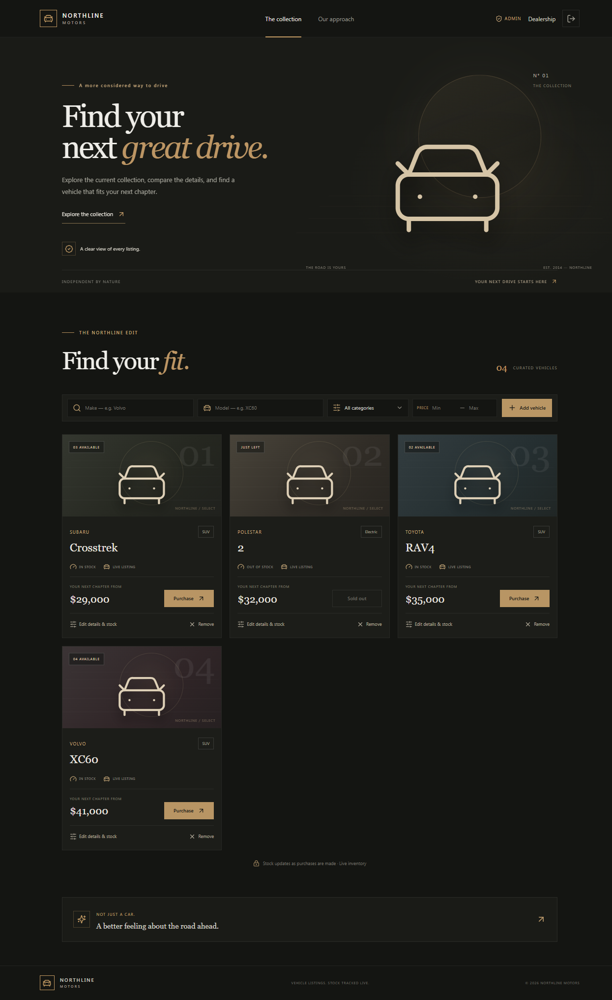
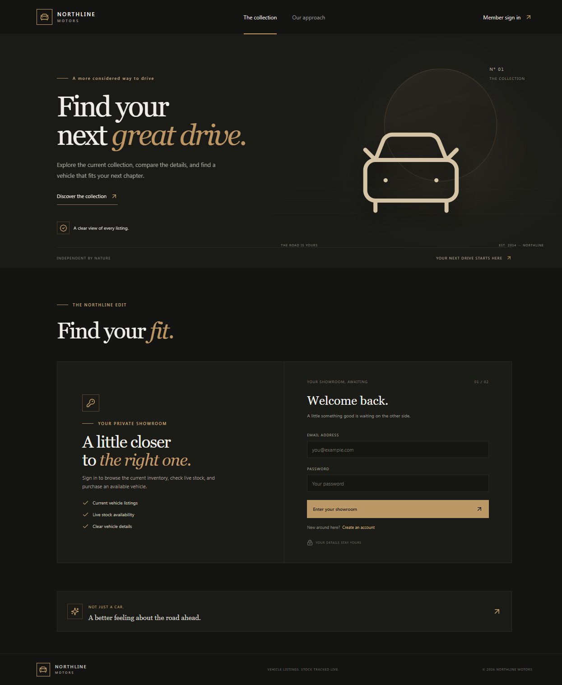
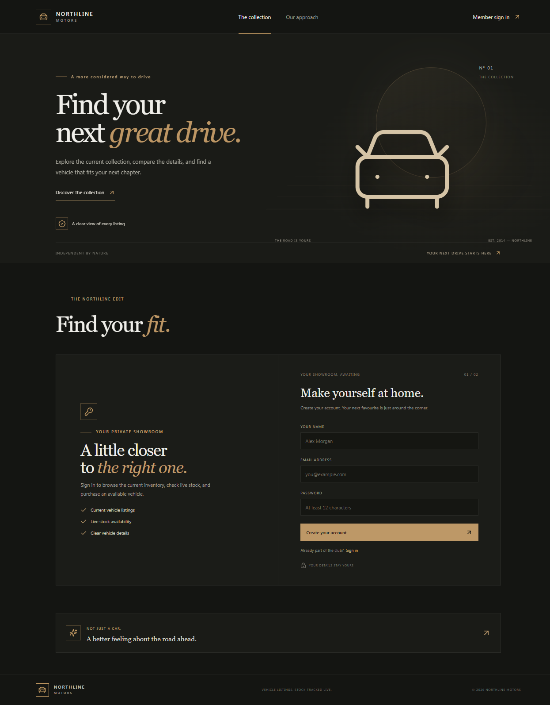

# Apex Auto — Car Dealership Inventory

A full-stack dealership website with a public dealership landing page and enquiry form, separate role-based customer and administrator views, an authenticated REST API, and persistent SQLite storage.

## Features

- Create an account, sign in, and access protected endpoints with expiring JWTs.
- Browse the public dealership landing page and learn about the dealership without an account.
- Submit general or vehicle-specific enquiries as a guest or signed-in customer.
- Use the protected showroom to explore listed stock and the administrator workspace to manage all inventory.
- Review live inventory metrics and process/search paginated customer enquiries from the administrator dashboard.
- Hide unlisted vehicles from customer catalogue, detail, AI recommendation, comparison, and purchase routes.
- Sort and paginate inventory results from the database.
- Purchase a vehicle with an atomic stock decrement and a historical unit-price snapshot; vehicles at zero stock cannot be purchased.
- Give administrators a separate inventory-management experience for adding, editing, and removing vehicles.
- Search available inventory with the AI Car Finder using natural-language requirements; compare up to three vehicles with explanations grounded in recorded catalog data.
- Use the Apex Auto navy-and-blue storefront on desktop and mobile, with live API/database readiness and per-request status and timing diagnostics.
- Navigate the storefront with visible keyboard focus, a skip-to-content link, responsive controls, and keyboard-accessible modal dialogs.
- Store optional vehicle specifications, while leaving unknown data explicitly unrecorded.
- Record listing status, variant, description, and secure HTTPS image links. Images must use external persistent hosting; uploads are not implemented.
- Persist users, inventory, and purchase records in a local SQLite database. Passwords are stored as bcrypt hashes.
- Upgrade database schema with versioned SQL migrations.
- Run the React/Tailwind development server and API together, or build a production frontend served by the API.

## Technology

- **API:** Node.js, Express 5, Zod request validation, bcrypt, and JSON Web Tokens.
- **Database:** SQLite through Node's built-in `node:sqlite` module. It uses a file on disk; no in-memory database or external database service is required.
- **Frontend:** React 19, Vite, Tailwind CSS 4, and custom responsive CSS.
- **Tests:** Node's built-in test runner and Supertest.

Vehicle and purchase amounts are stored and displayed in Indian rupees (INR). On upgrade, migration 004 converts existing USD amounts using a one-time rate of **₹95.001468 per USD**, the open.er-api.com reference rate updated 2026-10-25 UTC. The migration converts both current vehicle prices and existing purchase snapshots, rounds to two decimal places, and does not fetch a rate or perform repeated conversion at runtime. Review this rate and take a database backup before upgrading any production database.

Use **Node.js 22.13 or later**. No separate SQLite installation is needed.

## Run locally

In PowerShell, from the project root:

```powershell
npm.cmd install
$env:JWT_SECRET = "replace-this-with-a-long-random-secret"
npm.cmd run dev
```

The React app is at `http://localhost:5173`; its `/api` requests and `/healthz` readiness check are proxied to the API at `http://localhost:3001`. When using a shell where `npm` works directly, the `.cmd` suffix is optional.

The default persistent database is `data\dealership.db`; the API applies versioned migrations at startup. To select a different database file, set `DATABASE_PATH` before starting the API. Migration scripts live in `backend\migrations`; SQLite's `user_version` records the applied schema version. No sample vehicles are seeded automatically; add verified dealership inventory through the administrator account rather than displaying fictional records as live stock.

To inspect local tables and relations, open `data\dealership.db` with [DB Browser for SQLite](https://sqlitebrowser.org/). Use its **Database Structure** tab for tables/indexes and **Browse Data** for records. Back up the database before making schema/data changes and stop the running app before direct edits. Do not expose or commit the database file.

### Website routes and roles

- `/` is the public landing page and dealership overview; inventory and AI search are not shown there.
- `/login` is the shared customer/admin sign-in. Successful customer sign-in opens `/showroom`; administrator sign-in opens `/admin/dashboard`.
- `/showroom` is the authenticated customer catalogue and AI finder. `/admin/dashboard` and `/admin/inventory` require administrator access.
- `/vehicles` and `/vehicles/:id` require sign-in and direct users to the role-appropriate view; `/contact` accepts guest enquiries.
- Registration always creates a customer account. Create/promote the initial administrator using `seed-admin.js` above.

### Create the first administrator

Registration intentionally creates ordinary user accounts only. In a second PowerShell window, set a valid email address and use a strong, unique password that is at least 12 and at most 72 UTF-8 bytes:

```powershell
$env:ADMIN_EMAIL = "admin@example.com"
$env:ADMIN_PASSWORD = "replace-this-with-a-unique-password"
node backend\seed-admin.js
```

This creates the initial administrator in the same database used by the API. If the email already exists as a regular account, the command promotes that account without changing its existing password. Sign in with that account to manage inventory. `ADMIN_NAME` is optional and defaults to `Dealership Admin`.

### Production build

```powershell
npm.cmd run build
$env:JWT_SECRET = "replace-this-with-a-long-random-secret"
$env:NODE_ENV = "production"
npm.cmd start
```

The production server listens on port `3001` by default, serves the built React app from `dist`, and requires a `JWT_SECRET` of at least 32 bytes. Override the listening port with `PORT` and the database filename with `DATABASE_PATH`.

## Docker deployment

The Docker image builds the frontend, installs only production dependencies in the runtime image, and runs Node as an unprivileged user. The included Compose service drops Linux capabilities, uses a read-only root filesystem, and stores SQLite data in a persistent named volume.

1. Install Docker Engine and the Docker Compose plugin on the host.
2. Copy `.env.example` to `.env`, then replace the deliberately invalid `JWT_SECRET` value with a unique secret generated by `node -e "console.log(require('node:crypto').randomBytes(32).toString('hex'))"`. The deterministic finder needs no external credential. To enable provider-backed parsing, set `AI_PROVIDER=openai-compatible`, `AI_API_KEY`, and `AI_MODEL` in `.env`; never commit `.env`.
3. After the GitHub Actions workflow publishes the image, pull and start it with `docker compose pull` followed by `docker compose up -d`. If the GHCR package is private, authenticate to `ghcr.io` first. It listens on `127.0.0.1:3001`; the named `dealership-data` volume persists the database.
4. Create the first administrator by setting `ADMIN_EMAIL` and `ADMIN_PASSWORD` in the shell, then run `docker compose run --rm -e ADMIN_EMAIL -e ADMIN_PASSWORD dealership node backend/seed-admin.js`.
5. For a public website, configure a TLS reverse proxy (such as Caddy or a cloud load balancer) on the host and forward to port 3001. Keep the app port private. Set `TRUST_PROXY_HOPS` in `.env` to the exact number of trusted proxies between clients and the app; leave it unset/zero when directly accessed. Do not trust arbitrary forwarded headers.
6. Back up the Docker volume and verify that the hosting provider preserves persistent storage. SQLite is intended for a single app instance; use a shared client/server database before running multiple replicas.

The Compose port is loopback-only by default. If the reverse proxy is on another machine, change the published bind address deliberately and restrict it with the host firewall.

The database is upgraded by SQL migrations at application startup. Before deploying this release to an existing installation, take a verified backup of the persistent database and confirm the host has enough writable space. Tokens issued before the `jti` revocation change are no longer accepted; users must sign in again. Vehicle image URLs must point to an externally hosted, persistent HTTPS resource; no local image upload directory is provided.

## CI/CD and security

`.github/workflows/ci-cd.yml` runs API tests, an npm vulnerability audit, a production build, a Docker build, a Trivy high/critical image scan, and an HTTP smoke/load test on pull requests and pushes to `main`. Successful pushes to `main` also publish `ghcr.io/raghavkedia05/car-dealership:latest` and a commit-SHA tag using the built-in `GITHUB_TOKEN`.

No GitHub secrets are required for CI or image publishing. For a live deployment, you still need to provision the Docker host or container service, persistent storage, DNS/TLS, and the production `JWT_SECRET` yourself. After the first successful publish, choose whether the GHCR package is public; a private package requires image-pull credentials on the deployment host. Check that repository/org Actions policy permits packages:write if publishing is blocked.

The app sends Helmet security headers, including a content security policy, and limits login/registration attempts per client IP. The built-in rate limiter uses in-memory counters; for multiple app replicas, also enforce authentication rate limits at the trusted edge or configure a shared rate-limit store.

## Stress test

Run the app in Docker first, then exercise its health and frontend endpoints:

```powershell
docker compose pull
docker compose up -d
npm.cmd run stress -- --url http://127.0.0.1:3001 --duration 30 --concurrency 50
```

The script reports requests/second, p50/p95/p99 latency, and failures; it fails on request errors or when p95 exceeds 2 seconds by default. Adjust the maximum with `--max-p95-ms`. The CI workflow uses a shorter smoke load of 20 concurrent clients. These are baseline capacity checks, not a maximum-capacity certification; use representative data and only load-test systems you own or are authorized to test.

## API

API routes use the `/api` prefix; the health endpoint is `/healthz`. Send and receive JSON. Except for registration and login, routes require a bearer access token. The full endpoint contract is in [`docs/api.md`](docs/api.md), with an OpenAPI 3.0 file at [`docs/openapi.yaml`](docs/openapi.yaml).

| Method | Endpoint | Access | Purpose |
| --- | --- | --- | --- |
| `POST` | `/api/auth/register` | Public | Register with `name`, `email`, and a 12–72-byte `password`. |
| `POST` | `/api/auth/login` | Public | Sign in with `email` and `password`; returns an 8-hour token and user. |
| `GET` | `/api/auth/me` | Signed in | Return the current public user profile. |
| `POST` | `/api/auth/logout` | Signed in | Revoke the current token. |
| `GET` | `/api/public/vehicles` | Public | Search listed vehicles by keyword, category, specifications, and price. |
| `GET` | `/api/public/vehicles/:id` | Public | Read one listed vehicle. |
| `POST` | `/api/enquiries` | Public / optional account | Submit a general or vehicle-specific enquiry. |
| `GET` | `/api/vehicles` | Signed in | List inventory; customers see listed vehicles, admins see all. |
| `GET` | `/api/vehicles/search` | Signed in | Filter inventory with sorting and pagination. |
| `GET` | `/api/vehicles/:id` | Signed in | Read one visible vehicle. |
| `POST` | `/api/vehicles` | Admin | Create a vehicle and listing metadata. |
| `PUT` | `/api/vehicles/:id` | Admin | Update vehicle details, listing status, and image URL. |
| `DELETE` | `/api/vehicles/:id` | Admin | Remove a vehicle unless historical purchase records exist. Returns `204` or `409`. |
| `POST` | `/api/vehicles/:id/purchase` | Signed in | Purchase one vehicle, decrement stock, and record the price snapshot atomically. Returns `409` if it is sold out. |
| `POST` | `/api/vehicles/:id/restock` | Admin | Add a positive integer quantity using `{ "quantity": 5 }`. |
| `POST` | `/api/ai/car-finder` | Signed in | Interpret a natural-language query and rank available catalog vehicles. |
| `POST` | `/api/ai/car-finder/compare` | Signed in | Compare up to three current catalog records. |
| `GET` | `/api/admin/dashboard` | Admin | Read live inventory/enquiry metrics and recent records. |
| `GET` | `/api/admin/enquiries` | Admin | Search, filter, and paginate customer enquiries. |
| `PATCH` | `/api/admin/enquiries/:id` | Admin | Update enquiry status. |

The finder works without an AI credential using deterministic, server-side parsing. To opt into OpenAI-compatible interpretation, set `AI_PROVIDER=openai-compatible`, `AI_API_KEY`, and `AI_MODEL` on the server; optionally set `AI_BASE_URL` for a compatible endpoint. The user query is sent to that configured provider. Provider failures fall back to deterministic parsing and are identified in the response. Never put provider credentials in frontend code.

Example search:

```text
GET /api/vehicles/search?make=Volvo&category=SUV&minPrice=25000&maxPrice=60000
```

A vehicle has a server-generated UUID `id`, non-empty `make`, `model`, and `category`, positive numeric `price`, and non-negative integer `quantity`. Invalid input returns `400`, unauthenticated requests return `401`, and insufficient privileges return `403`.

This remains the established Node/Express + React + SQLite application rather than being rewritten to FastAPI/PostgreSQL: the existing implementation and deployment are built around this stack, and a wholesale replacement would risk losing verified behavior. See [`docs/architecture.md`](docs/architecture.md) for trade-offs and limitations.

## Screenshots

The screenshots below document the previous Northline visual theme. The current storefront uses Apex Auto branding and a navy-and-blue responsive design; the underlying login, inventory, and administrator workflows remain the same.







## Tests and test report

Run the API tests and production build:

```powershell
npm.cmd test
npm.cmd run build
```

The suite exercises registration and password hashing, login and role protection, invalid input, inventory filtering/sorting/pagination, administrator catalog operations, atomic purchases and price snapshots, restocking, migration versioning, and persistence across SQLite connections.

**Latest verified results:** 39 tests passed, 0 failed, 0 skipped, and `npm.cmd run build` passed after adding the public catalogue, enquiry, dashboard, and listing-visibility flows. Run the suite/build again after subsequent changes; the previously recorded coverage and audit figures predate these routes.

These figures were recorded from actual commands; they do not imply frontend unit/E2E coverage. Docker is not installed in the current verification environment, so a fresh local image build was not run. See [`docs/testing.md`](docs/testing.md) for scope and limitations and rerun `npm.cmd run test:coverage` for a fresh report.

Collect Node's built-in coverage summary with:

```powershell
npm.cmd run test:coverage
```

## Git and test-driven development

The development history starts with the API behavior tests, recorded while the API implementation was absent (red), followed by the backend implementation that made the suite pass (green). Frontend, documentation, and additional persistence and validation tests follow those milestones. AI-assisted commits include the requested Copilot co-author trailer.

## My AI Usage

I used GitHub Copilot through an AI assistant using Copilot SDK in VS Code for implementation, test development, debugging, and documentation. This update adds the natural-language car finder, grounded recommendations and comparisons, optional vehicle specifications, and the one-time USD-to-INR data migration.

The assistant executed the 39-test suite, production frontend build, dependency audit, and browser checks of customer/admin sign-in destinations, the public catalogue and vehicle enquiry flow, administrator inventory editing, enquiry status changes, and mobile layout against an isolated temporary database. These are tool-executed checks, not a claim that I personally performed an independent review. Before using this for an assignment, I should add the specific code-review and interview-preparation work I personally completed.

[`PROMPTS.md`](PROMPTS.md) preserves the original project brief and earlier supplied prompt. The later AI Car Finder request is not included because its original attachment text was not available in this implementation context; prior assistant responses and chat turns are not reconstructed.

## Repository and deployment

This project is hosted at [RaghavKedia05/Car-Dealership](https://github.com/RaghavKedia05/Car-Dealership). No live deployment URL is currently available.
